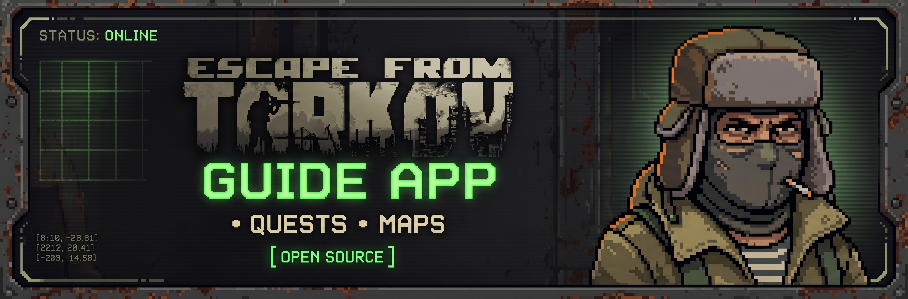

<p align="center">
  
</p>

<h1 align="center">Eftis</h1>

<p align="center">
  Локальный десктопный и веб-помощник для <em>Escape from Tarkov</em> (PvP и PvE) на базе <strong>Tauri v2</strong>, <strong>React + TypeScript</strong> и локального <strong>Python</strong>-бэкенда.<br />
  <a href="docs/GUIDE.md">Руководство пользователя</a> · <a href="config.example.json">Пример конфигурации</a> · <a href="LICENSE">Лицензия MIT</a>
</p>

---
<p align="center">
  
</p>

## Основные возможности

- **Трекер квестов и Kappa**: фильтрация по торговцам, локациям и статусам, отслеживание прогресса до подсумка Kappa, импорт истории выполнения из локальных логов игры.
- **Пошаговые гайды**: встроенные руководства с **Tarkov.Help** и данные **Tarkov.dev** (брифинг, цели, награды, скриншоты, разбивка по шагам и локальное кеширование).
- **Дерево квестов**: интерактивный граф зависимостей заданий с масштабированием, поиском и быстрой сменой статуса.
- **Интерактивные карты**: поэтажные векторные SVG-карты, слои выходов ЧВК/Диких, спавны боссов, ключи, квестовые зоны со всплывающими карточками, сворачиваемая панель фильтров и отображение позиции игрока по скриншоту.
- **Круг Сектантов**: подбор оптимальных по цене сборок под пороги `350 001 ₽` и `400 000 ₽` Base Value, калькулятор собственной корзины и таймеры ритуала (`6 ч` / `14 ч`).
- **Счётчик предметов**: учёт нужных предметов с импортом из активных квестов и быстрыми счётчиками.
- **Интерфейс и диагностика**: мгновенное переключение **RU / EN**, настраиваемые темы, сворачиваемая боковая панель, сворачивание в системный трей и встроенная консоль отладки по клавише `F12`.

---

## Безопасность

- **Только Read-Only (Zero-Touch)**: приложение не изменяет файлы игры, не читает память процесса, не перехватывает сетевой трафик и не рисует оверлеи поверх DirectX.
- Наблюдатель читает только текстовые `.log`-файлы клиента EFT и имена файлов скриншотов (обе опции отключаются в настройках).
- Весь прогресс, настройки и кеш хранятся локально в SQLite (`eft_assistant.db`): для десктопной версии — в `%APPDATA%\com.eftis.app`, для запуска из исходников — в корне проекта.

---

## Установка и запуск

### 1. Десктопное приложение (Windows)

Готовая сборка не требует установленного Python, Node.js или сторонних библиотек — бэкенд упакован в автономный сайдкар `eftis-backend.exe`:

1. Запустите установщик `Eftis-Setup-2.0.0-x64.exe` (или портативный бинарный файл `eftis.exe`).
2. При первом запуске приложение само создаст конфигурацию в `%APPDATA%\com.eftis.app` и откроет терминал.
3. При закрытии окна приложение может сворачиваться в системный трей с автоматической паузой фонового шейдера.

### 2. Режим разработки (Tauri + Vite + Python)

Требуются **Node.js 18+**, **Rust** (для Tauri v2) и **Python 3.10+**:

```powershell
npm install
npm run tauri dev
```

Команда автоматически поднимет dev-сервер Vite (`http://localhost:5173`) и запустит окно Tauri с локальным бэкендом.

### 3. Сборка установщика и сайдкара

Для сборки единого кастомного установщика `dist-installer/Eftis-Setup-2.0.0-x64.exe` (требуется `pyinstaller`):

```powershell
python scripts/build_installer.py
```

Скрипт последовательно соберёт Python-сайдкар (`scripts/build_backend.py`), основное приложение (`eftis.exe`), упакует их в `payload.zip` и скомпилирует кастомный Tauri-установщик из папки `installer/`.

### 4. Автономный веб-запуск (без Tauri)

Для работы без десктопной оболочки достаточно **Python 3.10+** (используется только стандартная библиотека):

- **Без консоли (Windows)**: дважды нажмите **`Start EFT Assistant.vbs`** или **`EFT Assistant.pyw`**. Для остановки используйте **`Stop EFT Assistant.pyw`**.
- **Из терминала**:
  ```powershell
  py -3 run.py
  ```
  После запуска откройте адрес из настроек (по умолчанию `http://127.0.0.1:8745/`).

---

## Конфигурация

При первом запуске создаётся файл `config.json` (шаблон — [`config.example.json`](config.example.json)):

| Параметр | По умолчанию | Описание |
| --- | --- | --- |
| `host` | `"127.0.0.1"` | Локальный адрес сервера |
| `port` | `8745` | Порт HTTP-сервера |
| `default_game_mode` | `"regular"` | Стартовый режим (`"regular"` для PvP или `"pve"`) |
| `language` | `"ru"` | Язык интерфейса и гайдов (`"ru"` / `"en"`) |
| `watch_logs` | `true` | Фоновое чтение логов EFT |
| `watch_screenshots` | `true` | Определение позиции по новым скриншотам |
| `auto_open_browser` | `true` | Автоматически открывать браузер в веб-режиме |
| `cache_ttl_minutes` | `15` | Время жизни кеша справочных данных |

---

## Структура проекта

```text
eft_assistant/
├── banner.jpg                  # Баннер проекта
├── icon.jpg                    # Иконка приложения
├── src/                        # Фронтенд (React 18 + TypeScript + Vite)
│   ├── api/                    # Клиент REST API бэкенда
│   ├── assets/                 # Графические ресурсы и логотип
│   ├── components/             # Вкладки, модальные окна, сайдбар, DebugConsole
│   ├── engines/                # Движки интерактивных карт и дерева квестов
│   ├── i18n/                   # Словари локализации (RU / EN)
│   ├── styles/                 # Стили и темы оформления
│   ├── theme/                  # Конфигурация тем и цветовых акцентов
│   ├── types/                  # TypeScript-типы API
│   └── utils/                  # Форматирование и клиентский логгер
├── src-tauri/                  # Десктопная оболочка Tauri v2 (Rust)
│   ├── src/main.rs             # Трей, single-instance, управление сайдкаром
│   ├── icons/                  # Иконки для EXE, трея и NSIS-установщика
│   └── tauri.conf.json         # Конфигурация окна, сборки и бандла
├── backend/                    # Локальный Python-сервер (stdlib)
│   ├── server.py               # HTTP-сервер и REST API
│   ├── tarkov_data.py          # Загрузка и кеширование Tarkov.dev и Tarkov.Help
│   ├── planner.py              # Логика квестов, Kappa и проекции на карты
│   ├── cultist_solver.py       # Оптимизатор сборок Круга Сектантов
│   ├── log_watcher.py          # Read-Only наблюдатель логов и скриншотов
│   └── db.py                   # Слой хранения SQLite
├── scripts/
│   └── build_backend.py        # Сборка сайдкара eft-backend.exe через PyInstaller
├── Start EFT Assistant.vbs     # Фоновый запуск веб-версии без консоли (Windows)
├── EFT Assistant.pyw           # Оконный/бесконсольный лаунчер Python
├── Stop EFT Assistant.pyw      # Остановка фонового веб-сервера
├── run.py                      # Точка входа бэкенда
├── config.example.json         # Пример конфигурации
├── docs/GUIDE.md               # Подробное руководство пользователя
└── tests/                      # Модульные тесты бэкенда
```

---

## Тестирование и проверка

```powershell
# Юнит-тесты бэкенда
python -m unittest discover -s tests -v

# Проверка типов и сборка фронтенда
npm run build
```

---

## Источники данных и дисклеймер

- **Игровые данные и SVG-карты**: [Tarkov.dev](https://tarkov.dev) (открытые JSON-выгрузки и SVG-карты сообщества `the-hideout`).
- **Пошаговые гайды по квестам**: [Tarkov.Help](https://tarkov.help) (загружаются локально по запросу пользователя с сохранением ссылки на оригинальную страницу; материалы и изображения гайдов не хранятся в репозитории).
- **Дисклеймер**: *Escape from Tarkov* является зарегистрированной торговой маркой Battlestate Games Limited. Данный проект — неофициальный open-source инструмент сообщества, не связанный с Battlestate Games и не одобренный ими.

---

## Лицензия

Проект распространяется под лицензией [MIT](LICENSE).
